# MINEAR

A mining game on NEAR. You burrow down as a mole, mine ores and gems, and keep what you mine on chain.

**Play the demo: https://testnet.minear.fun**

> **Status: a limited demo prototype on NEAR testnet.**
> - Testnet NEAR and the game's items have no money value. Balances, boards and accounts can be reset.
> - The game features in this build are also a limited demo: **depth, the core, boss souls and gear** (see
>   [Demo limits](#demo-limits)).
> - It runs on **NEAR testnet** (https://testnet.minear.fun), and on a **local testnet** on your own computer,
>   where a cheat system is on for fast testing.
> - Features in development are not shown in this repository.

<table>
<tr>
<td width="50%">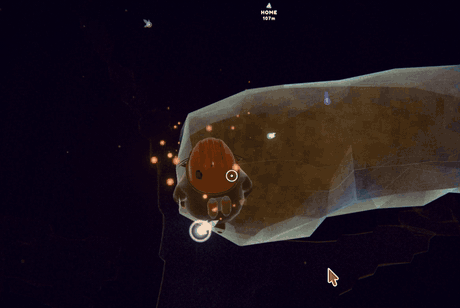<br><sub>Mine: burrow through the ground with your claws.</sub></td>
<td width="50%">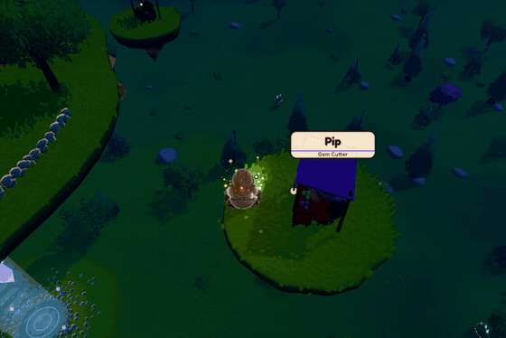<br><sub>Trade: six NPC merchants with their own NEAR wallets set the prices.</sub></td>
</tr>
</table>

## Documents

This README is the overview. Each topic has its own document.

| Document | What it has |
| - | - |
| [Merchants](wiki/ai-merchants.md) | The NPC merchants, how they set a price, and a market study over time: Open Supply and Capped Supply |
| [Contracts](wiki/contracts.md) | The game contract, the accounts, the flows on chain, gas and storage |
| [Catalog](wiki/catalog.md) | Gear, effect list, skill tree and materials, with the game's own art |
| [How to run](wiki/run.md) | NEAR testnet, the local testnet with cheats, the contract tests, settings |

## Contents

1. [The economy is the gameplay](#the-economy-is-the-gameplay)
2. [Gameplay](#gameplay)
3. [NPC merchants](#npc-merchants)
4. [Gear, effects and the skill tree](#gear-effects-and-the-skill-tree)
5. [On NEAR: the contract](#on-near-the-contract)
6. [Sign in with Google on a dev run](#sign-in-with-google-on-a-dev-run)
7. [Demo limits](#demo-limits)
8. [How to run](#how-to-run)
9. [Trailer](#trailer)
10. [License](#license)

## The economy is the gameplay

The brief of this build:

> **The economy is the gameplay.** Build NPCs with wallets, player-owned markets and economies that evolve
> without a dev patch. Judged on the game loop, not the token. Bonus if players never notice the chain.

How MINEAR answers each part:

| The brief | In MINEAR |
| - | - |
| NPCs with wallets | Six merchants. Each one is a NEAR account with its own key, its own stock and its own coins. Each one signs its own price offers. |
| Player-owned markets | A merchant with no cash closes. Players invest to open it again and become its shareholders: they get 125% back from its later sales. What players mine, sell, buy and burn is the only thing that moves a price. |
| Economies that evolve without a dev patch | `price = base x STOCK x DEMAND x WORLD`. Each factor is a fact on the chain. No developer sets a price, and nothing runs on a timer. |
| The game loop, not the token | Mine, come home, forge gear, go deeper. Trips give materials only. The coin is a tool for trade. |
| Players never notice the chain | Sign in with Google. No seed phrase, no wallet popup, no gas, no claim step. A trip is saved on chain when it ends. |

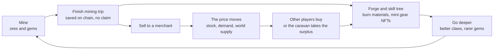

## Gameplay

The loop, one part at a time:
<table>
<tr>
<td width="50%"><br><b>1. Mine.</b> All the ground can be mined. The claws wear, so better claws go deeper.</td>
<td width="50%">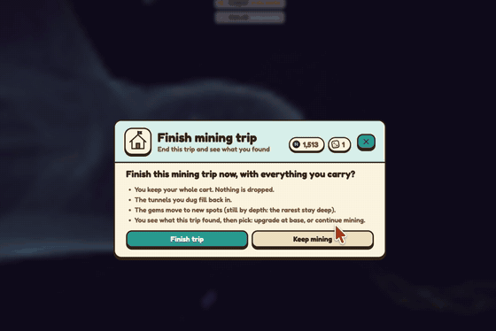<br><b>2. Finish the mining trip.</b> The summary shows the depth and the materials. The game saves them on chain at once.</td>
</tr>
<tr>
<td width="50%">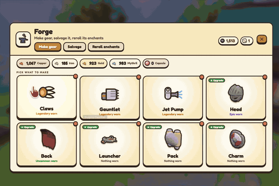<br><b>3. Forge gear.</b> Materials are burned and the gear is minted as an NFT in one call. The chain rolls the rarity.</td>
<td width="50%">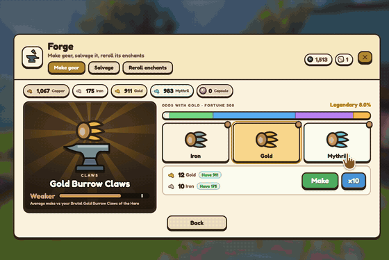<br><b>4. Make ten at once.</b> One call, ten pieces, one Legendary at most.</td>
</tr>
<tr>
<td width="50%">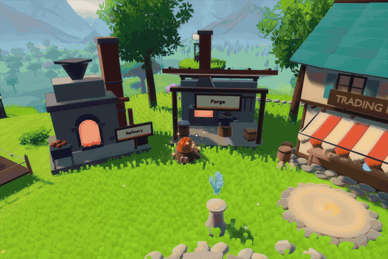<br><b>5. Equip.</b> Compare pieces and swap. The stats change at once.</td>
<td width="50%"><br><b>6. Trade.</b> Fly to a merchant's island and sell or buy. Each trade moves the price.</td>
</tr>
</table>

## NPC merchants

A merchant is an NPC with its own NEAR account. It stands at a stall on a floating island near the base. It
holds stock and coins, and it is always ready to buy and to sell. There is no order book. Each time a player
asks, the merchant reads the market from the contract, computes a price, and signs an offer that the contract
accepts for 20 seconds.

<table>
<tr>
<td width="50%">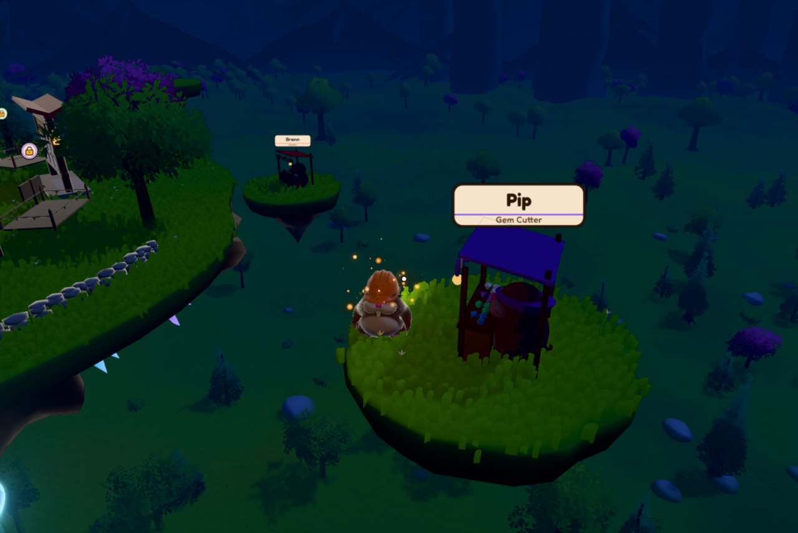<br><sub>Walk up to a merchant and press E.</sub></td>
<td width="50%">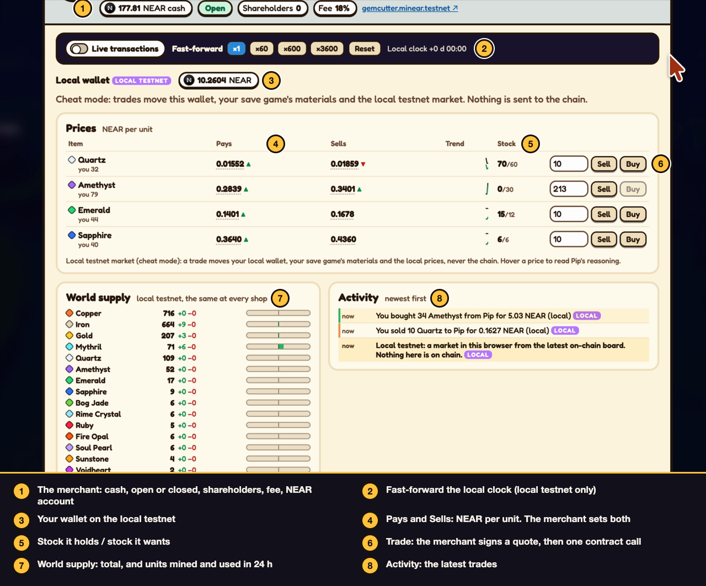<br><sub>The shop: prices, stock, world supply and the latest trades. The image is from the local testnet.</sub></td>
</tr>
</table>

How a merchant decides:

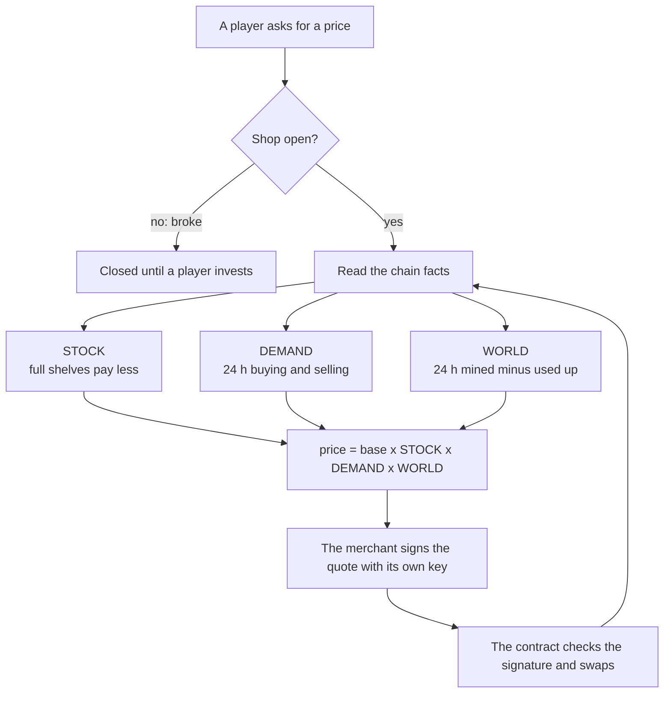

The market over time, from the model in the merchants document:

<table>
<tr>
<td width="50%">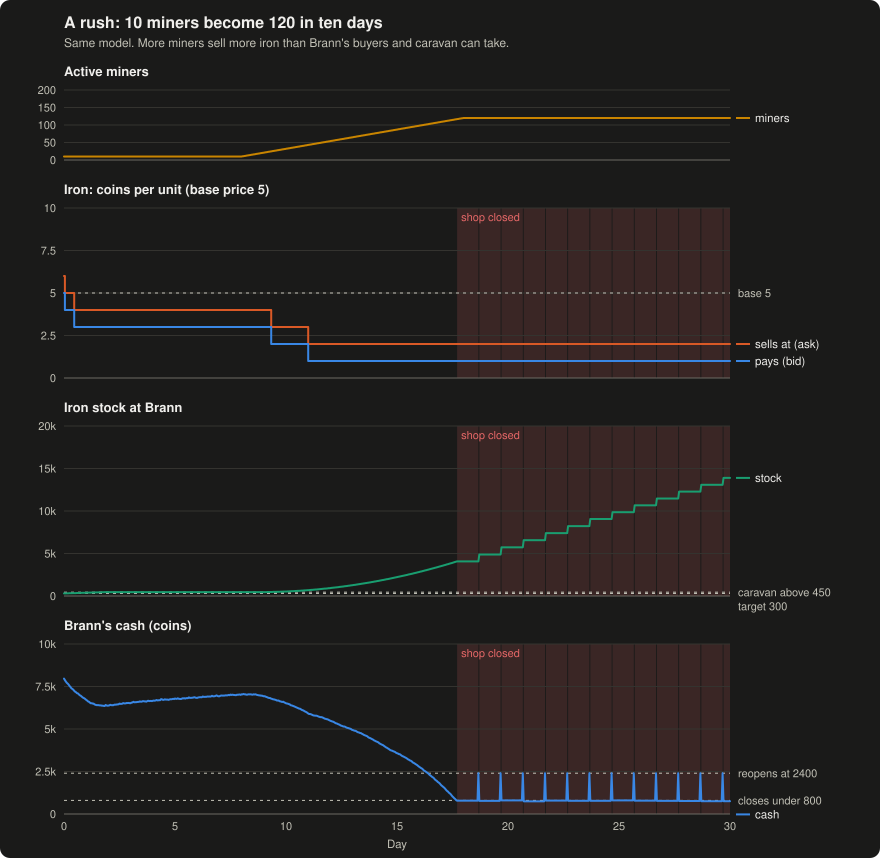<br><sub>A rush: more miners, lower price, and a shop that runs out of cash.</sub></td>
<td width="50%">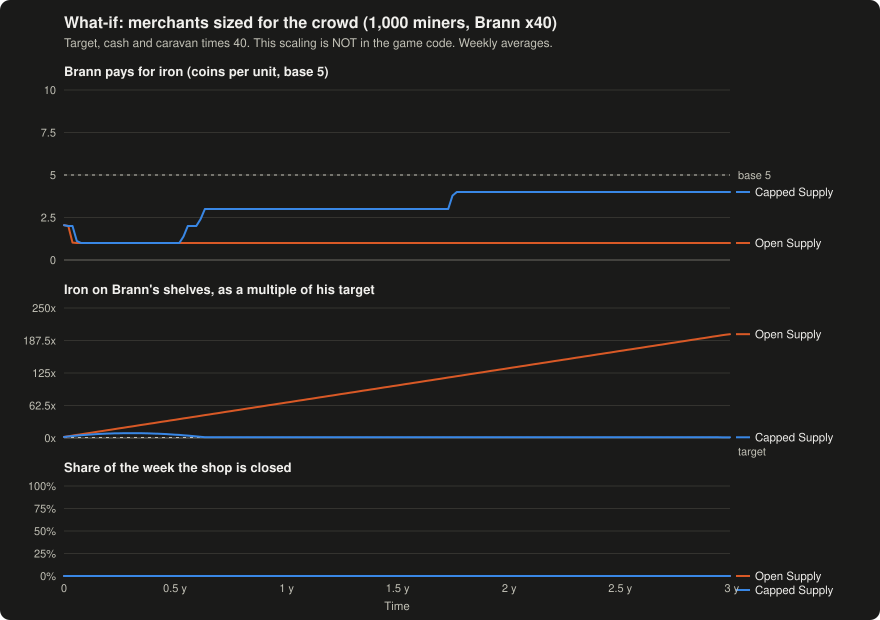<br><sub>Open Supply and Capped Supply, three years, with merchants sized for the crowd (a what-if).</sub></td>
</tr>
</table>

**Open Supply and Capped Supply.** The economy that runs now is **Open Supply**: mining has no supply limit,
and only an hourly cap and a cooldown limit a player. **Capped Supply** is a proposal that is not built: each
material has a maximum that can be mined, and the find chance falls as the supply runs out.

**Fast-forward (local testnet only).** The shop image above shows a Fast-forward bar (x1, x60, x600, x3600).
It is from the local testnet run of 2026-11-14 and it moved only the local market clock. The current code moves
the local market with bot miners. It was never on NEAR testnet.

Read more: **[Merchants: rules, flows and the market study](wiki/ai-merchants.md)**.

## Gear, effects and the skill tree

Gear is an NFT on NEAR (NEP-171). The Forge runs in the contract: it burns the materials, rolls the rarity from
the block's random seed and mints the piece. Each piece keeps a seed, and every client turns the seed into the
same effect lines. Skill tree levels are paid by burning on-chain materials.

<table>
<tr>
<td width="50%">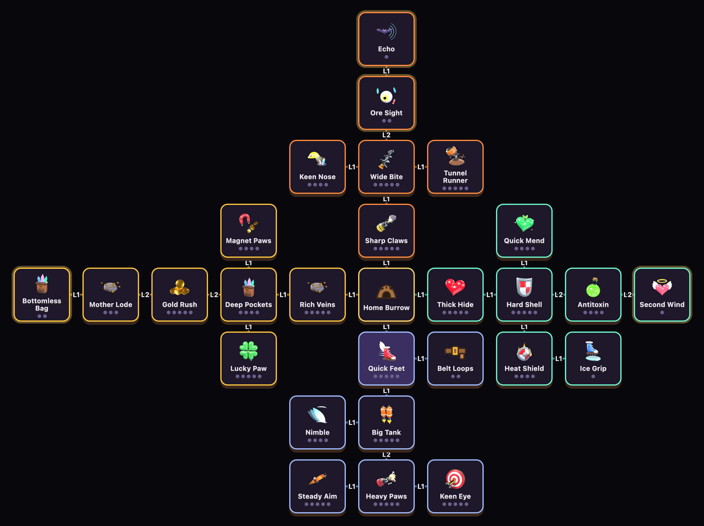<br><sub>Skill tree: 27 abilities, 105 levels, four branches.</sub></td>
<td width="50%">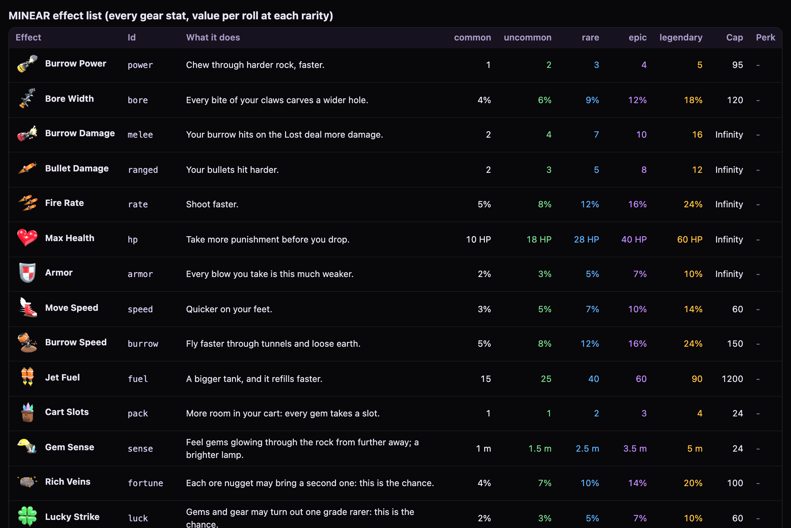<br><sub>Effect list: every gear stat and its value at each rarity.</sub></td>
</tr>
</table>

Read more: **[Catalog: gear, effects, skill tree and materials](wiki/catalog.md)**.

## On NEAR: the contract

The game runs on the real NEAR testnet. All game accounts are under `minear.testnet`, and one contract,
`items.minear.testnet`, holds everything.

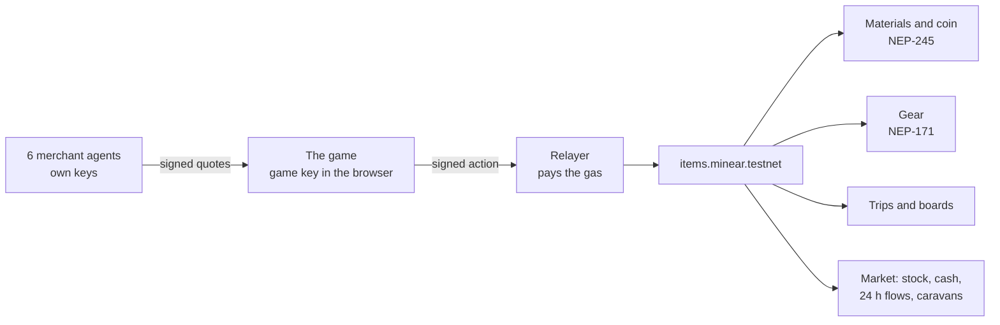

| Account | Role | Explorer |
| - | - | - |
| `items.minear.testnet` | The game contract | [view](https://testnet.nearblocks.io/address/items.minear.testnet) |
| `minear.testnet` | Owner of the contract. Creates player accounts. | [view](https://testnet.nearblocks.io/address/minear.testnet) |
| `relay.minear.testnet` | Gas relayer | [view](https://testnet.nearblocks.io/address/relay.minear.testnet) |

- **No popups.** Each way in ends with a game key in the browser: a function-call key for the game contract
  only, with no deposit. It can make game moves. It cannot move NEAR or gear.
- **No gas for new players.** The relayer pays for accounts that hold less than 0.15 NEAR, up to 240 actions
  for each account in one UTC day.
- **No claim step.** When a trip ends, one call mints the materials, records the trip and updates the boards.

Read more: **[Contracts: methods, flows, gas and storage](wiki/contracts.md)**.

## Sign in with Google on a dev run

To test Google sign-in on your computer, run the game against NEAR testnet and open it as
`http://localhost:3000`. NEAR Auth's shared testnet login allows only that address.

```bash
npm run dev:testnet
```

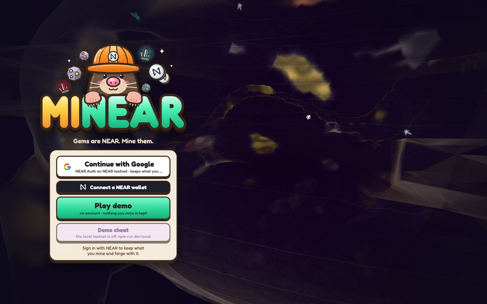

| Button | What it does |
| - | - |
| Continue with Google | NEAR Auth on NEAR testnet. The game creates `<name>.minear.testnet`. Keeps what you mine. |
| Connect a NEAR wallet | Your own testnet account. The wallet approves one game key for each browser. |
| Play demo | No account. Mining works, but nothing is kept. |
| Demo cheat | Dev runs only. The local testnet with cheats on. Off until `npm run dev:local` runs. |

## Demo limits

| Feature | In this demo | Full game |
| - | - | - |
| Depth | The world stops at Heartstone, about 1,100 m. The depth bar shows a DEMO tag. | Goes deeper |
| The core | The story's Inner Core at 100,000 m is in the intro film only | A place to reach |
| Boss souls | Kept in the save game, not on chain | Tokens |
| Gear | Eight pieces in four metals from the Forge, on chain | More pieces and sources |
| Trip depth | The game reports it. The contract checks only that it is inside the world. | A server confirms it |
| Chain | NEAR testnet, and a local testnet with cheats | NEAR mainnet |
| Supply | Open Supply | Capped Supply is a proposal |

## How to run

```bash
npm install
```

The game on NEAR testnet, page on http://localhost:3000:

```bash
npm run dev:testnet
```

The local testnet with the cheat system, page on http://127.0.0.1:5187/?mode=cheat:

```bash
npm run dev:local
```

Read more: **[How to run: tools, the local testnet, cheats, contract tests, settings and folders](wiki/run.md)**.

## Trailer

[](wiki/media/trailer.mp4)

The intro film, made with the game engine. Click the image for the video with sound
([`wiki/media/trailer.mp4`](wiki/media/trailer.mp4)).

## License

The code is under the MIT License (see `LICENSE`).

Third-party art keeps its own license:

- "Mole in a Jacket" by ghostmachinesing, https://sketchfab.com/3d-models/mole-in-a-jacket-db0517ffd3544c7e85e976c4ca9af8a5, CC-BY-4.0. Changes: scaled to 2.0 units tall, KayKit Rig_Medium skeleton fitted, skin weights added. File: `public/minear/mole_jacket.glb`.
- "Hard hat" by naira001, https://sketchfab.com/3d-models/hard-hat-a1328e74b0f44b4284af05eb2aa5cfb6, CC-BY-4.0. Changes: made 1 unit wide with its origin at the crown, textures reduced to 512 px JPEG. File: `public/minear/hats/hard_hat.glb`.
- KayKit Character Animations 1.1 by Kay Lousberg (www.kaylousberg.com), CC0. File: `public/minear/anims/crawl.glb`.

CC-BY-4.0 requires this credit wherever the game shows its credits.
