# MINEAR merchants: how six NPC shops run a market

[Back to the README](../README.md) · [Contracts](contracts.md) · [Catalog](catalog.md) · [How to run](run.md)

> **Status of this document.** Sections 1 to 4 describe the code that runs on NEAR testnet now.
> Sections 5 to 8 are a **model**: the real price rules, run on an assumed player population.
> They are a prediction, not a measurement. Section 7 compares the economy that runs now
> (**Open Supply**) with a proposal that is **not built** (**Capped Supply**).

All paths are in this repository (local folder name `minear-r3f`).

## Contents

1. [What a merchant is](#1-what-a-merchant-is)
2. [How a merchant decides a price](#2-how-a-merchant-decides-a-price)
3. [One trade, step by step](#3-one-trade-step-by-step)
4. [When a shop goes broke](#4-when-a-shop-goes-broke)
5. [The model and its assumptions](#5-the-model-and-its-assumptions)
6. [Results: the market over time](#6-results-the-market-over-time)
7. [Open Supply and Capped Supply](#7-open-supply-and-capped-supply)
8. [Findings](#8-findings)
9. [Fast-forward on the local testnet](#9-fast-forward-on-the-local-testnet)

## 1. What a merchant is

A merchant is an NPC with its own NEAR account. It holds stock and coins as balances in the game contract.
It always buys and always sells. There is no order book and no price that a developer sets: the merchant
computes a price from facts on the chain, each time a player asks.

<table>
<tr>
<td width="50%">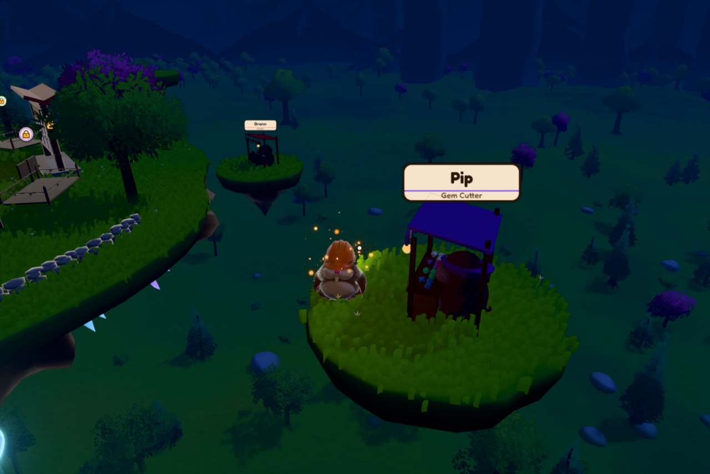<br><sub>Pip the Gem Cutter at his stall. Press E next to a merchant to open its shop.</sub></td>
<td width="50%">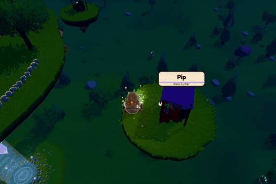<br><sub>The shop opens. The player sells Quartz and buys Amethyst. Each trade moves the price.</sub></td>
</tr>
</table>

The six merchants (`MERCHANTS` in [`src/economy/pricing.ts`](../src/economy/pricing.ts)):

| Merchant | Account | Trades | Start cash (coins) | Spread | Character |
| - | - | - | -: | -: | - |
| Brann, Smelter | `smelter.minear.testnet` | copper, iron, gold, mythril | 8,000 | 12% | Buys any ore. Thin margins. |
| Pip, Gem Cutter | `gemcutter.minear.testnet` | quartz, amethyst, emerald, sapphire | 12,000 | 18% | Common gems. Pays fair, sells fast. |
| Opaline, Jeweler | `jeweler.minear.testnet` | gold, ruby, sunstone, voidheart | 30,000 | 30% | Rich and patient. Charges for it. |
| Moss, Biome Trader | `wanderer.minear.testnet` | bog jade, rime, fire opal, soul pearl | 15,000 | 22% | Wants the stones of the biome caves. |
| Quill, Quartermaster | `quartermaster.minear.testnet` | copper, iron, quartz, amethyst | 3,000 | 15% | Small purse. Easy to break. |
| Ossian, Relic Broker | `relics.minear.testnet` | mythril, sunstone, voidheart, soul pearl | 12,000 | 35% | Thin market, wild prices. |

Items overlap on purpose. Two buyers for one item give the player a second price to check.

The shop window, with a breakdown and a clean version:

<table>
<tr>
<td width="50%">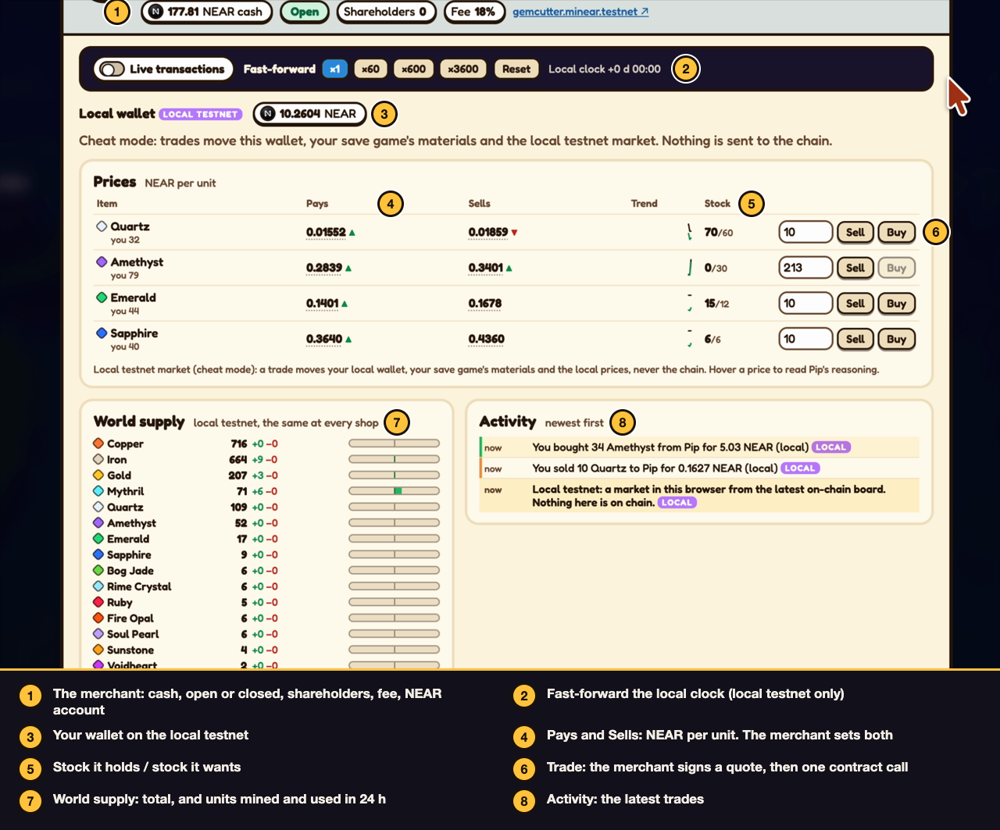<br><sub>Breakdown</sub></td>
<td width="50%">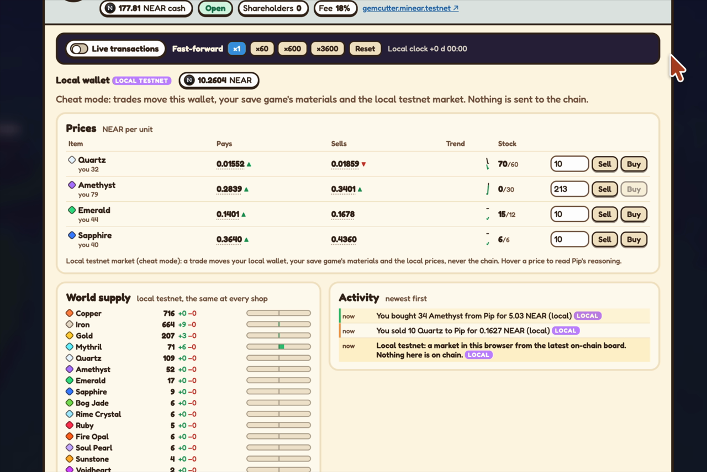<br><sub>Clean</sub></td>
</tr>
</table>

The game shows coin prices and balances as NEAR (display only, [`src/economy/nearDisplay.ts`](../src/economy/nearDisplay.ts)).
The contract and the merchants trade in the game coin. This document uses coins.

### Where the "AI" is

Each merchant is an **agent** on the MINEAR server ([`server/src/merchants.ts`](../server/src/merchants.ts)):
it has a key, it reads the market, and it signs an offer. Two parts:

| Part | What decides it | Can it change a price? |
| - | - | - |
| The price | Rules in [`src/economy/pricing.ts`](../src/economy/pricing.ts), from chain facts | Yes. This is the only source of a price. |
| The voice | An LLM on NEAR AI Cloud writes one line in character ([`server/src/talk.ts`](../server/src/talk.ts)) | No. A line with a number that is not in the facts is dropped. |

The agents act only when a player asks. They have no timers and they do not poll.

## 2. How a merchant decides a price

```
price = base x STOCK x DEMAND x WORLD

bid (what it pays you) = price x (1 - spread / 2) x CASH
ask (what it asks you) = price x (1 + spread / 2)
```

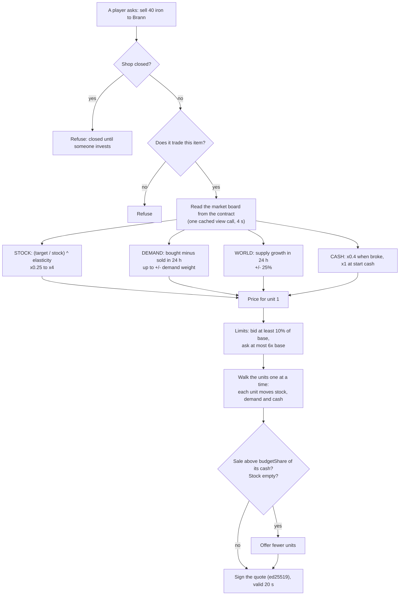

| Factor | What the merchant looks at | Effect |
| - | - | - |
| STOCK | Its stock against the stock it wants (`target`) | Full shelves pay less. Empty shelves pay more. |
| DEMAND | Units players bought from it minus units sold to it, last 24 h | More buying: price up. More selling: price down. |
| WORLD | For the whole game, last 24 h: units mined minus units used up, as a share of supply | Supply grows by half in a day: -25%. Crafting burns more than miners bring: up to +25%. |
| CASH | Its coins against its starting capital | A poor merchant pays less: x0.4 when broke. |
| CARAVAN | Stock above 1.5x target | The outside world buys up to 0.5x target per day for 60% of base. Coins enter the game. |

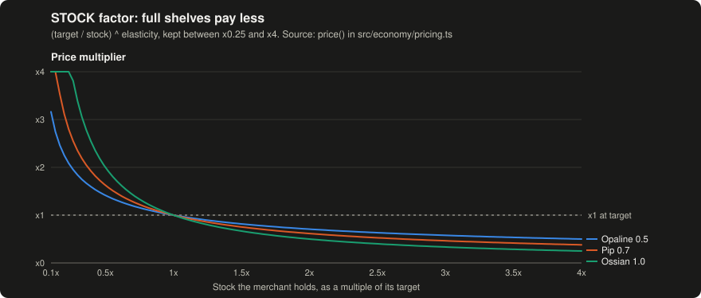

A quote for many units walks the price one unit at a time. A big sale gets a lower average price than a
small sale. This is the rule that stops one player from selling a full cart at the first price.

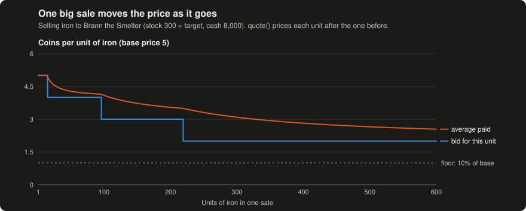

In this example the first unit of iron gets 5 coins and unit 300 gets 2. The average for 600 units is 2.54.

## 3. One trade, step by step

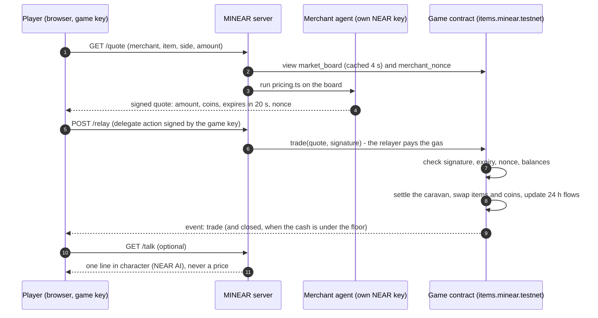

The contract does not compute the price. It checks that the merchant's own key signed the offer, that the
offer is for this player, that it is not expired, and that it was not used before. The contract records the
raw facts that the next price reads: stock, coins, 24 h buy and sell counts for each merchant, and 24 h mint
and burn counts for each item.

## 4. When a shop goes broke

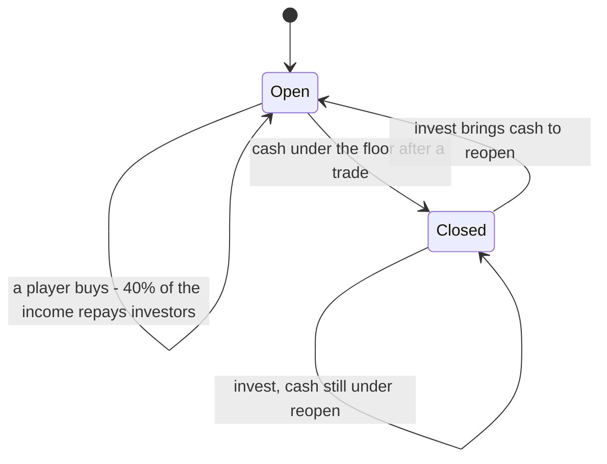

- A merchant with cash under its `floor` closes. The contract refuses trades with a closed shop.
- Any player can `invest` coins in a merchant. A closed shop opens again when its cash reaches `reopen`.
- An investor is owed 125% of the amount. The contract pays it from 40% of each later sale by that merchant.
- The shop window shows **Shareholders**: the investors that the merchant still owes.

This makes the market player-owned in part: players decide which shop gets capital, and they carry the risk.

## 5. The model and its assumptions

The script [`wiki/tools/market-model.ts`](tools/market-model.ts) imports `price`, `quote` and `caravan` from
[`src/economy/pricing.ts`](../src/economy/pricing.ts). It runs them on a modelled population, hour by hour.
It uses no chain, no server and no database. To make the charts again:

```bash
SCALE=40 bun wiki/tools/market-model.ts wiki/media/charts
```

| Assumption | Value | Source |
| - | - | - |
| One active miner plays | 1 hour a day | assumption |
| Finds per hour | 25% of the hourly save cap (iron: 75) | assumption, the same as the Capped Supply proposal |
| Share of finds sold to merchants | 25%, split between the merchants that trade the item | assumption |
| Share of finds used up (Forge, Refinery, skill tree) | 60% | assumption |
| A miner buys from the merchant | 0.4% of the merchant's target per day, when the ask is at most 1.5x base | assumption |
| A closed shop | investors bring it to `reopen` after 24 hours, every time | assumption |
| Price, quote, limits, caravan, floor, reopen, 125% and 40% | as in the code | `pricing.ts`, `contracts/items/src/game.rs` |

The numbers in the first six rows are not measured. Different values move the thresholds. The shapes of the
curves come from the rules.

## 6. Results: the market over time

### 6.1 A quiet month: the price finds a level

With 10 miners, Brann pays 3 to 5 coins for iron (base 5). His stock stops at the caravan line (450). His
cash stays above 6,300 coins. The shop never closes.

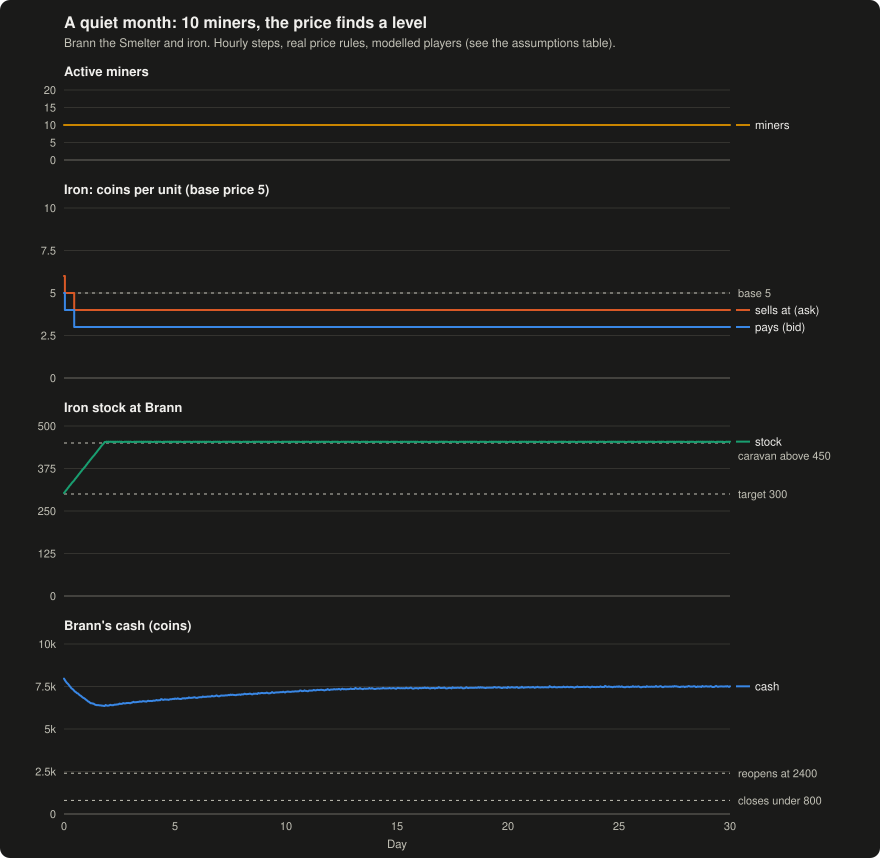

### 6.2 A rush: more miners than the shop can serve

The miners go from 10 to 120 in ten days. The bid falls to the floor (1 coin) before the peak. The stock
grows without limit, because the caravan removes only 150 iron a day. Brann's cash falls under 800 on day 17.7
and the shop closes. Investors open it again each day, and it closes again in hours.

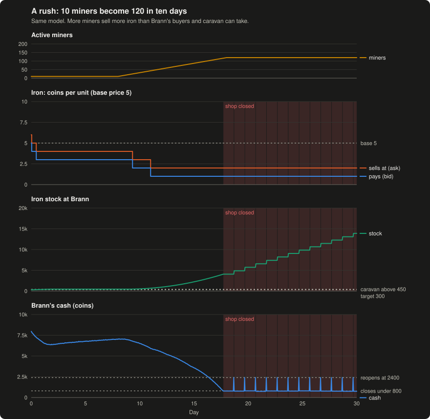

### 6.3 A small purse breaks first

Quill has 3,000 coins and may spend 35% of his cash on one sale. With 40 miners his shop closes on day 1.7
and stays closed for 91% of the month.

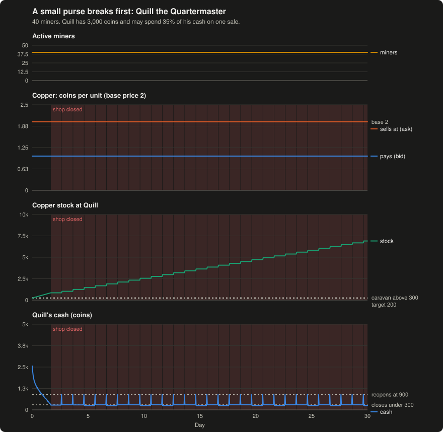

### 6.4 How many miners can one merchant serve?

Each point is one 60-day run with a steady number of miners.

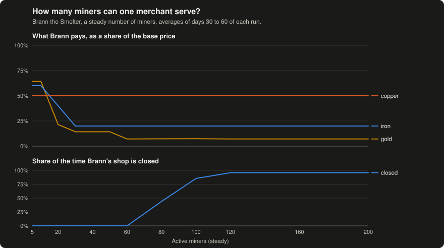

| Steady miners | Iron bid (share of base) | Gold bid (share of base) | Shop closed |
| -: | -: | -: | -: |
| 10 | 60% | 64% | 0% |
| 20 | 40% | 21% | 0% |
| 30 to 60 | 20% (floor) | 14% to 7% | 0% |
| 80 | 20% | 7% (floor) | 44% |
| 100 | 20% | 7% | 85% |
| 120 and more | 20% | 7% | 96% |

Copper stays at 50% of base in every run. The coin is a whole number, and the lowest bid is 1 coin. The copper
base is 2, so copper has only two prices.

### 6.5 Timeline of a growing world

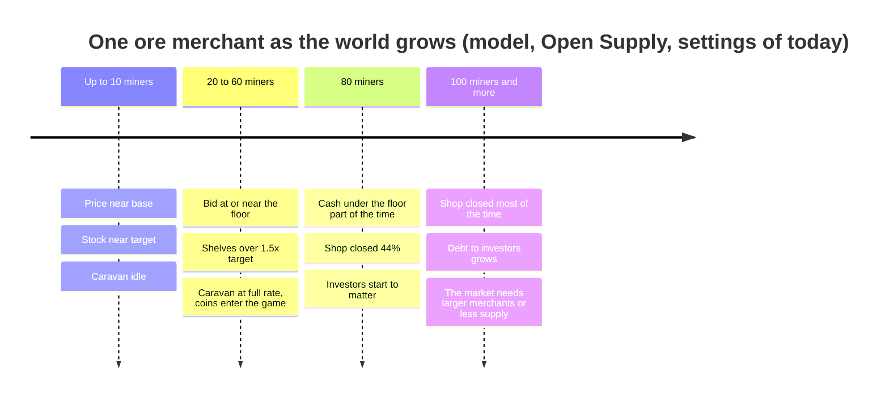

## 7. Open Supply and Capped Supply

| | **Open Supply** | **Capped Supply** |
| - | - | - |
| State | Runs now on NEAR testnet | Proposal. Not built. |
| Supply of a material | No limit | A fixed maximum that can be mined (copper: 50,000,000 in the proposal) |
| Limits on a player | Hourly cap for each material, 30 s between two saves | The same, plus a daily share |
| Find chance | From the area and the depth only | The same, times a find factor `D` that falls as the supply runs out |
| More miners | More units a day | The same units a day. `D` falls for each miner. |
| Crafting | Mints and burns | Mints into a "made" count. It does not use the minable limit. |

The Capped Supply formula in one line: a find is kept with the chance `D = min(x^0.5, D_ret)`. `x` is the
share of the minable supply that is left. `D_ret` is set again once a day, so that the whole game mines about
`E = E0 * x` units a day. This is the Bitcoin pattern: the schedule depends on supply, not on the number of
miners.

### 7.1 Supply

Model: 50 miners become 1,000 in the first year, then stay.

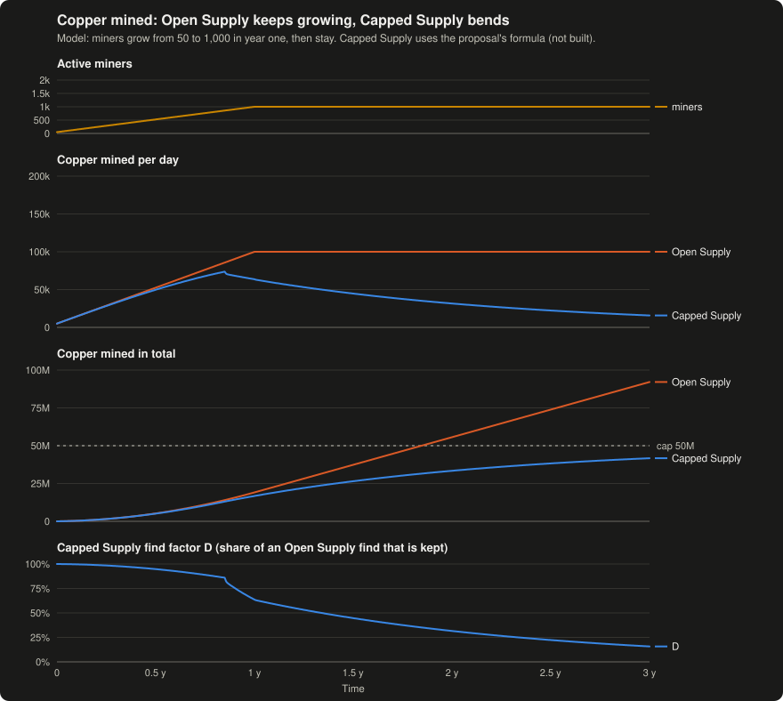

| After | Open Supply: copper mined | Capped Supply: copper mined | Capped find factor `D` |
| - | -: | -: | -: |
| 1 year | 19.2 M | 16.7 M | 64% |
| 2 years | 55.7 M | 33.4 M | 32% |
| 3 years | 92.2 M | 41.7 M (cap 50 M) | 16% |

### 7.2 The same merchant in both economies

Same miners, and Brann with the settings of today (target 300 iron, cash 8,000, caravan 150 a day).

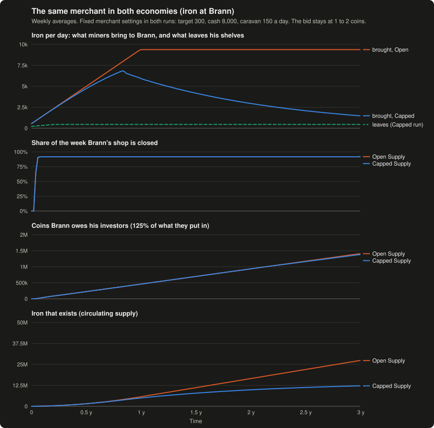

Both runs give the same result for the shop: the bid is at the floor, the shop is closed about 90% of the
time, and the debt to investors grows to about 1.4 M coins in three years. Capped Supply cuts the iron that
miners bring from 9,375 a day to 2,136 a day in year 3. That is still more than the 450 a day that leave the
shelves. **A supply cap does not repair a merchant that is too small for the crowd.**

### 7.3 What-if: merchants sized for the crowd

Here Brann's target, cash and caravan are 40 times larger (25 miners for each unit of merchant). The miner
count is 1,000 from day 0. **This scaling is not in the game code.**

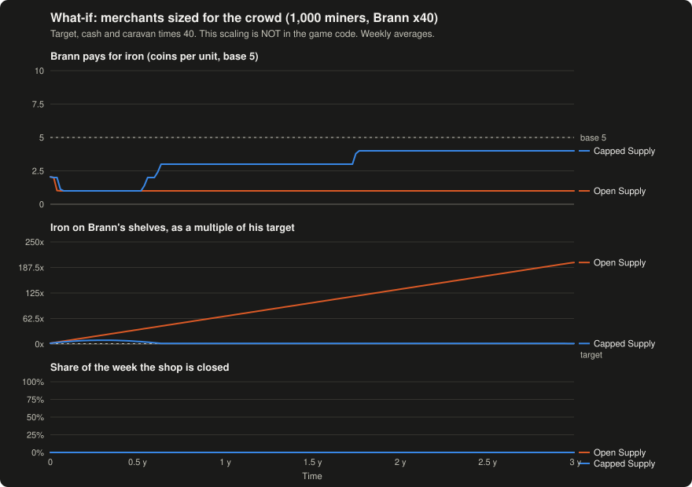

| Year | Open Supply: iron bid | Open Supply: stock / target | Capped Supply: iron bid | Capped Supply: stock / target |
| -: | -: | -: | -: | -: |
| 1 | 1.04 | 35x | 1.89 | 4.9x |
| 2 | 1.00 | 101x | 3.25 | 1.5x |
| 3 | 1.00 | 167x | 4.00 | 1.5x |

With large merchants the shop stays open in both economies. In Open Supply the shelves fill without limit and
the bid stays at the floor. In Capped Supply the find factor halves each year, the shelves empty to the
caravan line, and the bid climbs back to 80% of base.

## 8. Findings

1. **At demo scale the rules hold a price band.** With about 10 miners for each ore merchant, the price moves
   between 60% and 100% of base and no shop closes.
2. **The price reacts in the right direction with no developer action.** More sellers: lower bid, in hours.
   One big sale: lower average. Buyers and the caravan: the bid recovers.
3. **Merchant capacity is a constant, and supply scales with players.** Brann's caravan takes 150 iron a day,
   whatever the number of miners. In the model each miner brings 2.3 iron a day and buys back 1.2. From about
   30 miners the iron bid is at the floor, and from about 80 miners the shop starts to close.
4. **A closed shop needs players.** The contract opens a shop again only on `invest`. In a rush, investors are
   repaid slowly and the debt grows. Investing is a real risk, which is the intended player-owned part.
5. **Capped Supply limits the total, not the daily pressure on a small merchant.** It halves the supply after
   two years in the model, and it cannot keep a small shop open by itself (7.2).
6. **Capped Supply and larger merchants together give a rising price.** In the what-if run the bid goes from
   1.9 to 4.0 coins in three years, where Open Supply stays at 1.0 (7.3).
7. **Prediction for the next step:** merchant targets, cash and caravan rates must grow with the count of
   active miners. The Capped Supply proposal already counts active miners on chain, so the same number can
   size the merchants.

Limits of this work: one merchant at a time, one assumed player type, no price arbitrage between merchants, no
bots, and whole-coin rounding. The bot miners ([`server/tools/bots.ts`](../server/tools/bots.ts)) are the next
test: they trade through the real relayer and contract on the local testnet.

## 9. Fast-forward on the local testnet

The recording of 2026-11-14 shows a **Fast-forward** bar in the shop window of the local testnet (cheat) run:
x1, x60, x600, x3600 and a local clock (part 2 of the breakdown image in section 1). It moved the local market
clock, so that caravans and the 24 h windows could be seen in minutes. It was never on NEAR testnet.

The current code does not have this bar. The local testnet now runs real quotes and real trades on a local
NEAR chain, and the bot miners move the market:

```bash
npm run dev:local
```

```bash
npm run local:bots
```

See [How to run](run.md).
