# MINEAR catalog: gear, effects, skill tree and materials

[Back to the README](../README.md) · [Merchants](ai-merchants.md) · [Contracts](contracts.md) · [How to run](run.md)

This page uses the game's own art. The tables come from the live game data: [`src/state/skillTree.ts`](../src/state/skillTree.ts),
[`src/state/gearStats.ts`](../src/state/gearStats.ts), [`src/economy/forgeRules.ts`](../src/economy/forgeRules.ts) and
[`src/economy/catalog.ts`](../src/economy/catalog.ts). The icons are in [`public/cards`](../public/cards).

> **Demo scope.** The lists below are the demo set. The full game has more gear, more materials and deeper layers.

## What is on NEAR

| Thing | On chain as | Standard | Notes |
| - | - | - | - |
| Ores and gems | Tokens in `items.minear.testnet` | NEP-245 multi-token | Minted when a mining trip ends (`save_trip`) |
| Game coin | A token in the same contract | NEP-245 | Shown as NEAR in the game (display only) |
| Gear | One NFT for each piece | NEP-171, NEP-177, NEP-181 | Made by the Forge on chain. Rarity from the block's random seed. |
| Gear effects | A seed stored in the gear NFT | | Every client turns the seed into the same effect lines |
| Skill tree levels | Paid by burning on-chain materials | | The levels are kept in the save game. They are not NFTs. |

## 1. Gear [SAMPLE]

Gear is made at the Forge. One call to the contract burns the materials and mints the piece.

<table>
<tr>
<td width="50%">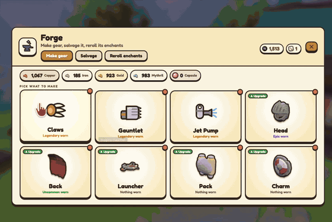 One make: pick the piece and the metal, and the chain rolls the rarity.</td>
<td width="50%">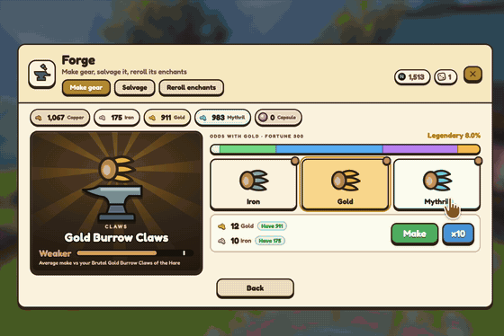 x10: ten pieces in one call. One Legendary at most for each call.</td>
</tr>
<tr>
<td width="50%">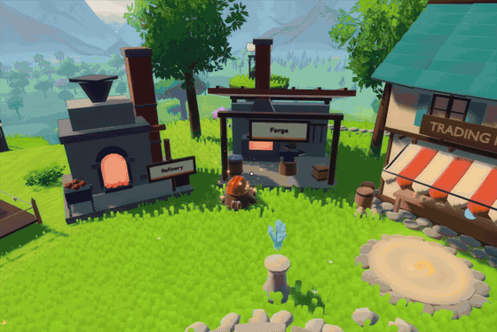 The gear page: swap a piece and the stats change at once.</td>
<td width="50%">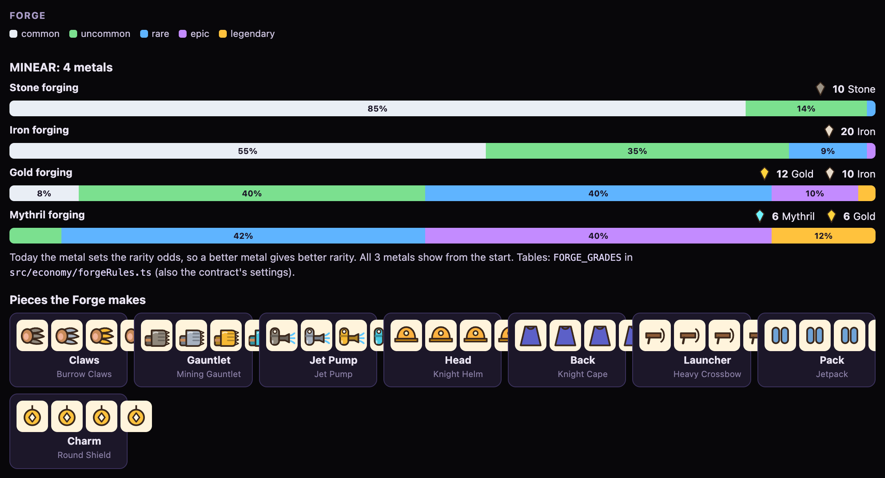 Odds by metal, and the eight pieces the Forge makes.</td>
</tr>
</table>

### Forge grades and rarity odds

| Grade | One make burns | common | uncommon | rare | epic | legendary |
| - | - | -: | -: | -: | -: | -: |
| Stone forging | 10 stone | 85% | 14% | 1% | 0% | 0% |
| Iron forging | 20 iron | 55% | 35% | 9% | 1% | 0% |
| Gold forging | 12 gold + 10 iron | 8% | 40% | 40% | 10% | 2% |
| Mythril forging | 6 mythril + 6 gold | 0% | 6% | 42% | 40% | 12% |

Pieces: Burrow Claws, Mining Gauntlet, Jet Pump (the three claw tools), Knight Helm, Knight Cape, Heavy Crossbow,
Jetpack, Round Shield.

### Reroll and salvage

**Reroll** keeps the built-in effect and rolls all other effect lines again. **Salvage** breaks a spare piece into ore.

| Rarity | Extra effect lines | Reroll burns | Salvage gives |
| - | -: | - | - |
| common | 1 | nothing to reroll | 6 copper, 2 iron |
| uncommon | 2 | 4 gold | 8 iron |
| rare | 3 | 6 gold | 6 iron, 4 gold |
| epic | 3 | 2 mythril | 6 gold, 2 mythril |
| legendary | 4 | 4 mythril | 6 mythril |

### Claws and endurance

The claws wear while you mine. Better metal lasts longer underground.

| Claws | Endurance |
| - | -: |
| Bare Claws | 15 |
| Stone Claws | 30 |
| Copper Claws | 50 |
| Iron Claws | 80 |
| Gold Claws | 120 |
| Mythril Claws | 170 |

## 2. Effect list [DEMO]

Every gear stat, and the value of one roll at each rarity. A piece has one built-in effect, plus extra lines by rarity (common 1, uncommon 2, rare 3, epic 3, legendary 4).

The demo list:

| | Effect | Id | What it does | common | uncommon | rare | epic | legendary |
| - | - | - | - | -: | -: | -: | -: | -: |
| 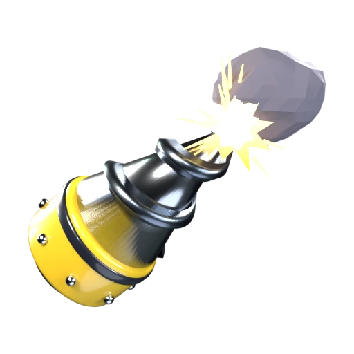 | **Burrow Power** | `power` | Chew through harder rock, faster. | 1 | 2 | 3 | 4 | 5 |
| 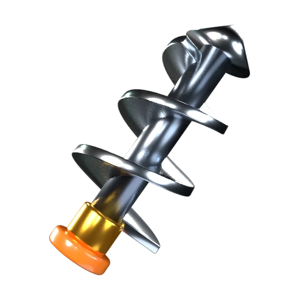 | **Bore Width** | `bore` | Every bite of your claws carves a wider hole. | 4% | 6% | 9% | 12% | 18% |
| 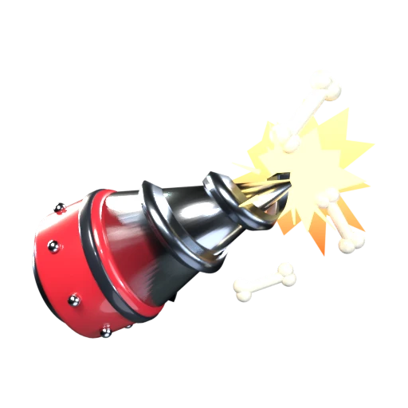 | **Burrow Damage** | `melee` | Your burrow hits on the Lost deal more damage. | 2 | 4 | 7 | 10 | 16 |
|  | **Bullet Damage** | `ranged` | Your bullets hit harder. | 2 | 3 | 5 | 8 | 12 |
| 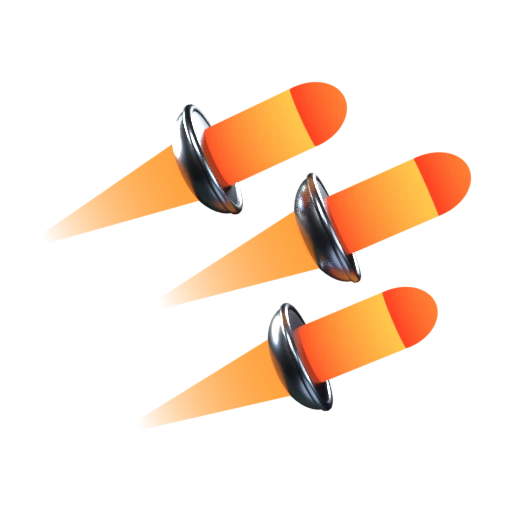 | **Fire Rate** | `rate` | Shoot faster. | 5% | 8% | 12% | 16% | 24% |
|  | **Max Health** | `hp` | Take more punishment before you drop. | 10 HP | 18 HP | 28 HP | 40 HP | 60 HP |
| 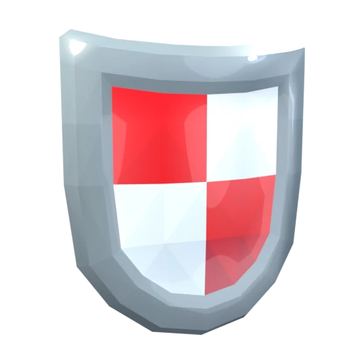 | **Armor** | `armor` | Every blow you take is this much weaker. | 2% | 3% | 5% | 7% | 10% |
| 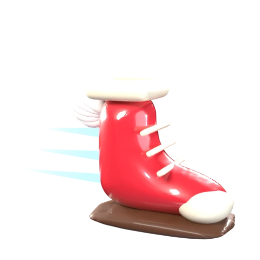 | **Move Speed** | `speed` | Quicker on your feet. | 3% | 5% | 7% | 10% | 14% |
| 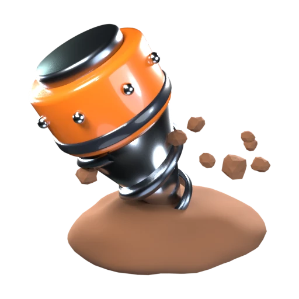 | **Burrow Speed** | `burrow` | Fly faster through tunnels and loose earth. | 5% | 8% | 12% | 16% | 24% |
| 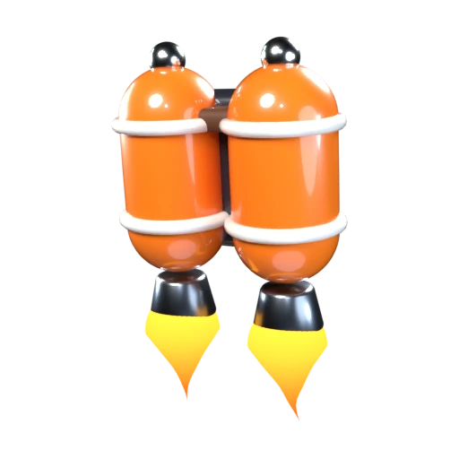 | **Jet Fuel** | `fuel` | A bigger tank, and it refills faster. | 15 | 25 | 40 | 60 | 90 |
| 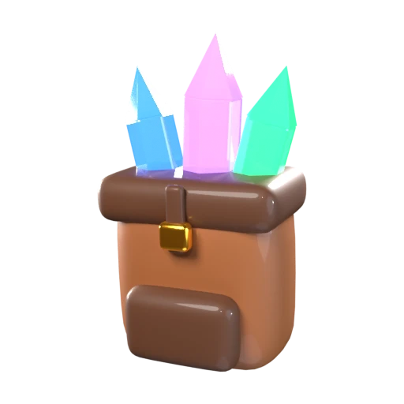 | **Cart Slots** | `pack` | More room in your cart: every gem takes a slot. | 1 | 1 | 2 | 3 | 4 |
| 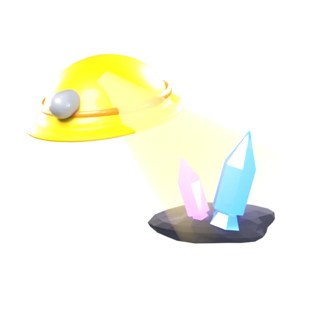 | **Gem Sense** | `sense` | Feel gems glowing through the rock from further away; a brighter lamp. | 1 m | 1.5 m | 2.5 m | 3.5 m | 5 m |
| 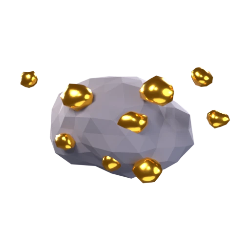 | **Rich Veins** | `fortune` | Each ore nugget may bring a second one: this is the chance. | 4% | 7% | 10% | 14% | 20% |
|  | **Lucky Strike** | `luck` | Gems and gear may turn out one grade rarer: this is the chance. | 2% | 3% | 5% | 7% | 10% |
|  | **Crit Chance** | `crit` | More of your blows land as critical hits, for 1.5x damage. | 2% | 3% | 5% | 7% | 10% |
|  | **Regeneration** | `regen` | Health creeps back once you are out of a fight. | 0.3 HP/s | 0.5 HP/s | 0.8 HP/s | 1.2 HP/s | 2 HP/s |
| 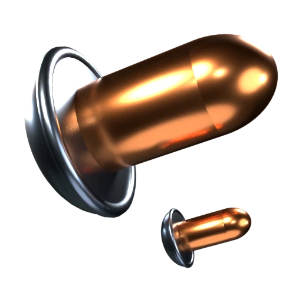 | **Heavy Bullets** | `caliber` | Bigger bullets: easier to land, and they knock back harder. | 6% | 10% | 15% | 20% | 30% |
| 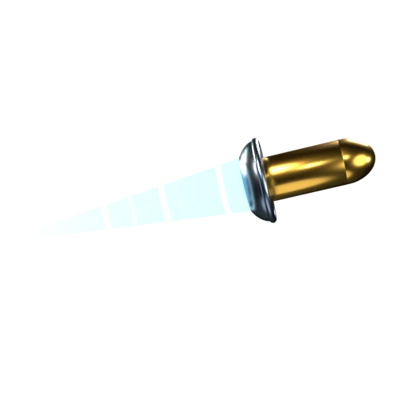 | **Swift Bullets** | `muzzle` | Bullets fly faster and flatter: easier to lead a moving target. | 6% | 10% | 15% | 20% | 30% |
|  | **Vampire Claws** | `vamp` | Every burrow hit heals you this share of the damage it deals. | 0% | 0% | 3% | 5% | 8% |
| 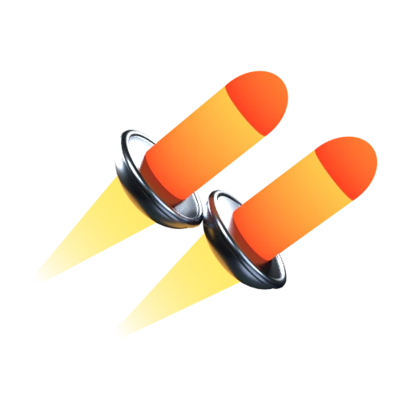 | **Twin Bullets** | `twin` | The chance each shot fires a second bullet alongside. | 0% | 0% | 15% | 25% | 40% |
| 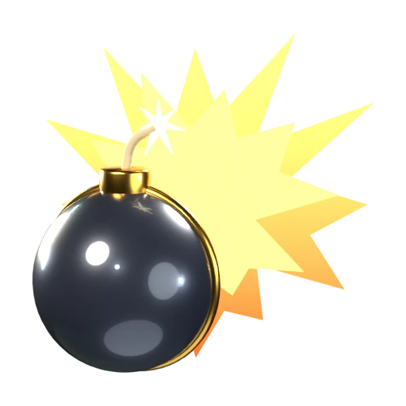 | **Blasting Caps** | `blast` | Every bullet bursts where it lands, dealing this share of its damage around it. | 0% | 0% | 25% | 40% | 65% |
| 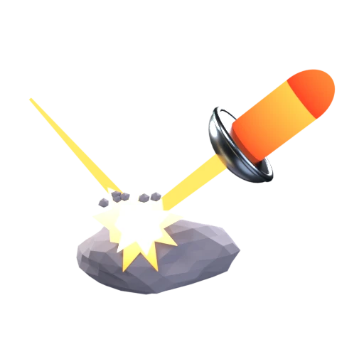 | **Ricochet** | `bounce` | The chance a bullet that hits rock glances off and flies on. | 0% | 0% | 30% | 45% | 65% |
|  | **Spiked Coat** | `thorns` | Whatever hits you up close takes this share of the blow back (another miner, a fifth of it). | 0% | 0% | 8% | 12% | 20% |
|  | **Nimble** | `nimble` | Dash again this much sooner, and stay untouchable a little longer. | 0% | 0% | 15% | 22% | 30% |
|  | **Gold Rush** | `gold` | Gem sales pay this much more. | 0% | 0% | 8% | 12% | 20% |
|  | **Magnet** | `magnet` | Loot lying around flies to you from further away. | 0 m | 0 m | 2 m | 3 m | 5 m |
|  | **Second Wind** | `wind` | Once per trip, a knockout blow leaves you standing instead. | 0 | 0 | 0 | 0 | 1 |
| 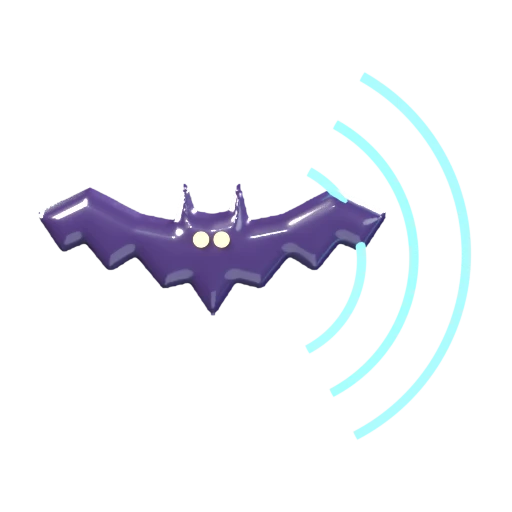 | **Echo** | `echo` | Press Q while burrowing to send a sonar ping whenever you like. | 0 | 0 | 1 | 0 | 0 |
|  | **Ember Bullets** | `ember` | Every hit sets its target burning for 3 s: this share of the bullet's damage each second. | 0% | 0% | 10% | 15% | 24% |
|  | **Venom Bullets** | `venom` | Every hit poisons for 5 s: this share of the bullet's damage each second, up to three doses. | 0% | 0% | 6% | 9% | 14% |
|  | **Frost Bullets** | `frost` | Every hit slows its target this much, for 1.6 s. | 0% | 0% | 10% | 15% | 22% |
| 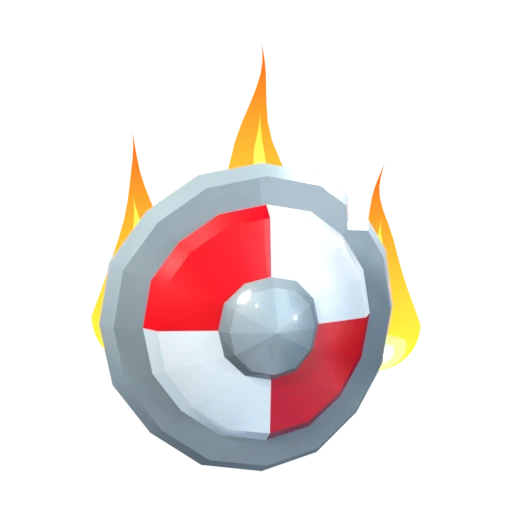 | **Heat Shield** | `resfire` | Lava and fire burn you less. | 8% | 12% | 18% | 25% | 35% |
| 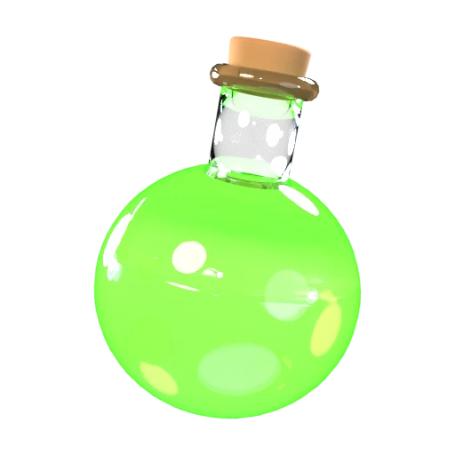 | **Antitoxin** | `respoison` | Poison and the Bog's water hurt you less. | 8% | 12% | 18% | 25% | 35% |
| 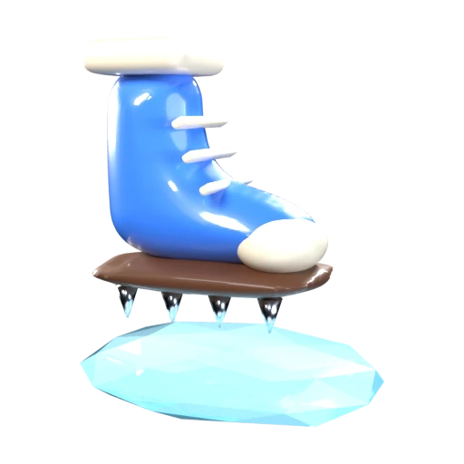 | **Ice Grip** | `grip` | Spiked soles: you don't slide on ice. | 0 | 0 | 1 | 1 | 1 |
|  | **Ore Sight** | `oresight` | Ore veins glimmer through the murk in burrow vision. | 0 | 0 | 1 | 1 | 0 |

## 3. Skill tree [DEMO]

Only 27 abilities and 105 levels within demo version. Home Burrow is in the middle. Four branches grow from it: Digging (up), Fortune and loot
(left), Survival (right), Travel and Combat (down). A line label **L2** means that the next ability opens when this one
reaches level 2. Abilities are paid in materials only: ore from the ore bin and gems from the gem bag. There is no coin fee.

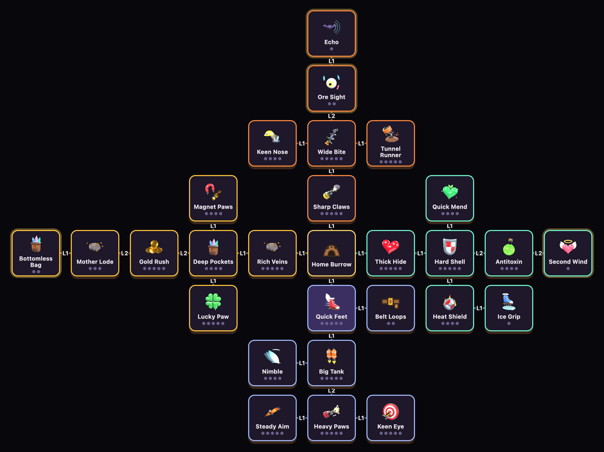

**Digging**

| | Ability | Levels | Each level adds | Opens after | Level 1 costs |
| - | - | -: | - | - | - |
|  | **Sharp Claws** | 5 | 1 Burrow Power | Home Burrow | 8 copper |
|  | **Wide Bite** | 5 | 5% Bore Width | Sharp Claws L1 | 12 copper, 2 quartz |
|  | **Keen Nose** | 4 | 1 m Gem Sense | Wide Bite L1 | 5 iron, 13 copper, 1 amethyst |
|  | **Tunnel Runner** | 5 | 8% Burrow Speed | Wide Bite L1 | 5 iron, 13 copper, 1 amethyst |
|  | **Ore Sight** | 2 | 1 Ore Sight | Wide Bite L2 | 3 gold, 8 iron, 1 emerald |
|  | **Echo** | 1 | 1 Echo | Ore Sight L1 | 2 mythril, 5 gold, 1 sapphire |

**Fortune and loot**

| | Ability | Levels | Each level adds | Opens after | Level 1 costs |
| - | - | -: | - | - | - |
|  | **Rich Veins** | 5 | 4% Rich Veins | Home Burrow | 8 copper |
|  | **Deep Pockets** | 4 | 1 Cart Slots | Rich Veins L1 | 12 copper, 2 quartz |
|  | **Magnet Paws** | 4 | 1 m Magnet | Deep Pockets L1 | 5 iron, 13 copper, 1 amethyst |
|  | **Lucky Paw** | 5 | 2% Lucky Strike | Deep Pockets L1 | 5 iron, 13 copper, 1 amethyst |
|  | **Gold Rush** | 5 | 5% Gold Rush | Deep Pockets L2 | 5 iron, 13 copper, 1 amethyst |
|  | **Mother Lode** | 3 | 6% Rich Veins | Gold Rush L2 | 3 gold, 8 iron, 1 emerald |
|  | **Bottomless Bag** | 2 | 2 Cart Slots | Mother Lode L1 | 2 mythril, 5 gold, 1 ruby |

**Survival**

| | Ability | Levels | Each level adds | Opens after | Level 1 costs |
| - | - | -: | - | - | - |
|  | **Thick Hide** | 5 | 10 HP Max Health | Home Burrow | 8 copper |
|  | **Hard Shell** | 5 | 2% Armor | Thick Hide L1 | 12 copper, 2 quartz |
|  | **Quick Mend** | 4 | 0.3 HP/s Regeneration | Hard Shell L1 | 5 iron, 13 copper, 1 amethyst |
|  | **Heat Shield** | 4 | 8% Heat Shield | Hard Shell L1 | 5 iron, 13 copper, 1 amethyst |
|  | **Antitoxin** | 4 | 8% Antitoxin | Hard Shell L2 | 5 iron, 13 copper, 1 amethyst |
|  | **Ice Grip** | 1 | 1 Ice Grip | Heat Shield L1 | 3 gold, 8 iron, 1 emerald |
|  | **Second Wind** | 1 | 1 Second Wind | Antitoxin L2 | 2 mythril, 5 gold, 1 sapphire |

**Travel and Combat**

| | Ability | Levels | Each level adds | Opens after | Level 1 costs |
| - | - | -: | - | - | - |
|  | **Quick Feet** | 5 | 3% Move Speed | Home Burrow | 8 copper |
|  | **Belt Loops** | 2 | 1 belt slot | Quick Feet L1 | 24 copper, 4 quartz |
|  | **Big Tank** | 5 | 15 Jet Fuel | Quick Feet L1 | 12 copper, 2 quartz |
|  | **Nimble** | 4 | 5% Nimble | Big Tank L1 | 5 iron, 13 copper, 1 amethyst |
|  | **Heavy Paws** | 5 | 3 Burrow Damage | Big Tank L2 | 5 iron, 13 copper, 1 amethyst |
|  | **Steady Aim** | 5 | 2 Bullet Damage | Heavy Paws L1 | 3 gold, 8 iron, 1 emerald |
|  | **Keen Eye** | 5 | 2% Crit Chance | Heavy Paws L1 | 3 gold, 8 iron, 1 emerald |

## 4. Materials

Materials come from mining trips. The hourly cap is the most that one player can save in one hour.

| | Material | Token id | Kind | Tier | Base price (coins) | Cap per hour |
| - | - | - | - | -: | -: | -: |
|  | Stone | `ore.stone` | ore | 1 | 1 | 600 |
|  | Copper | `ore.copper` | ore | 1 | 2 | 400 |
|  | Iron | `ore.iron` | ore | 2 | 5 | 300 |
|  | Gold | `ore.gold` | ore | 3 | 14 | 150 |
|  | Mythril | `ore.mythril` | ore | 4 | 40 | 60 |
| 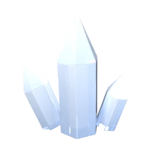 | Quartz | `gem.quartz` | gem | 1 | 30 | 120 |
| 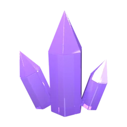 | Amethyst | `gem.amethyst` | gem | 2 | 80 | 60 |
| 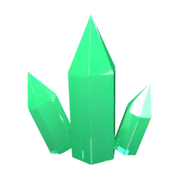 | Emerald | `gem.emerald` | gem | 3 | 200 | 30 |
| 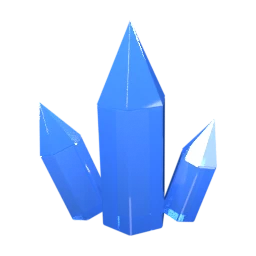 | Sapphire | `gem.sapphire` | gem | 3 | 420 | 20 |
| 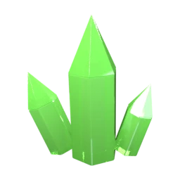 | Bog Jade | `gem.bogjade` | gem | 3 | 480 | 12 |
| 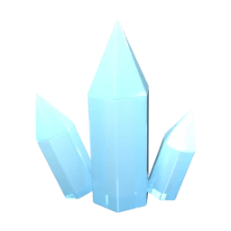 | Rime Crystal | `gem.rime` | gem | 3 | 520 | 12 |
| 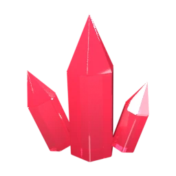 | Ruby | `gem.ruby` | gem | 4 | 900 | 10 |
| 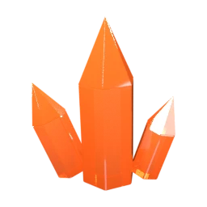 | Fire Opal | `gem.fireopal` | gem | 4 | 1150 | 8 |
| 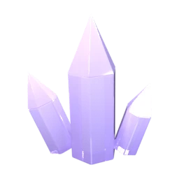 | Soul Pearl | `gem.soulpearl` | gem | 4 | 1300 | 8 |
| 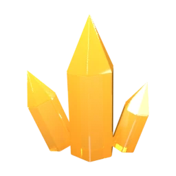 | Sunstone | `gem.sunstone` | gem | 5 | 2400 | 4 |
|  | Voidheart | `gem.voidheart` | gem | 6 | 7000 | 2 |

The Refinery smelts five of an ore into one of the next ore: copper to iron, iron to gold, gold to mythril.

## 5. See these pages in the running game

The catalog pages of a dev run show the same data with every level's cost:

- `/dev/catalog/near`: base buildings, Refinery, Forge, effects, Capsule Machine, skill tree, slots, Requests Board
- `/dev/catalog`: foes, bosses, gems, gear, characters and sky states

See [How to run](run.md).
