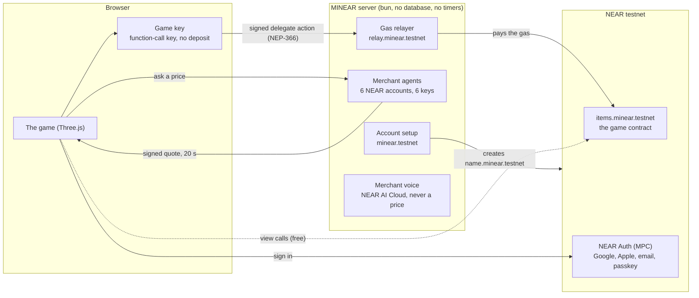
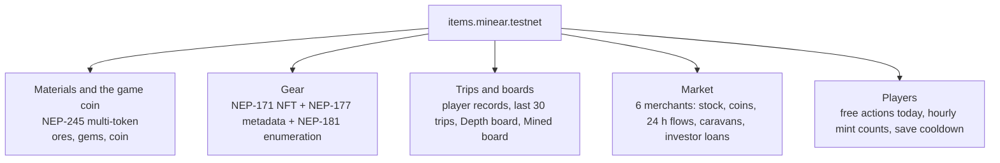
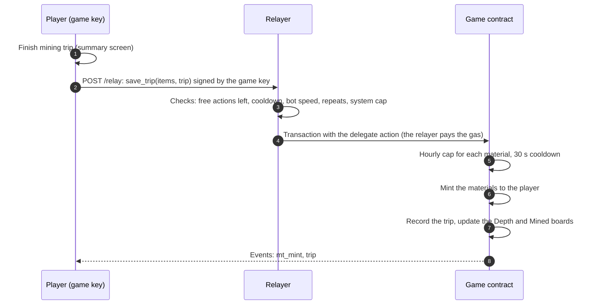
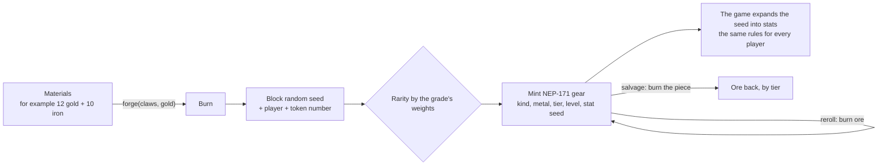
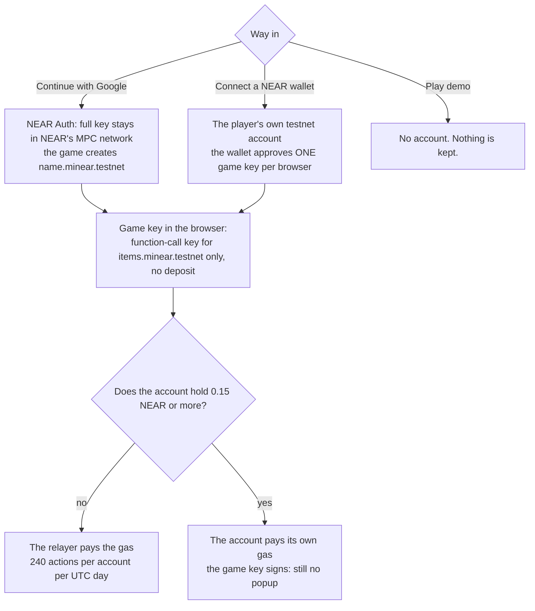

# MINEAR contracts and the live system

[Back to the README](../README.md) · [Merchants](ai-merchants.md) · [Catalog](catalog.md) · [How to run](run.md)

All paths are in this repository (local folder name `minear-r3f`). The game has **one** contract:
`items.minear.testnet`, source in [`contracts/items/src`](../contracts/items/src) (Rust, near-sdk).

## 1. The system in one picture



## 2. Accounts

| Account | Role | Explorer |
| - | - | - |
| `items.minear.testnet` | The game contract | [view](https://testnet.nearblocks.io/address/items.minear.testnet) |
| `minear.testnet` | Owner of the contract. Creates player accounts. Tops up storage and gas. | [view](https://testnet.nearblocks.io/address/minear.testnet) |
| `relay.minear.testnet` | Gas relayer: pays the gas of players who hold no NEAR | [view](https://testnet.nearblocks.io/address/relay.minear.testnet) |
| `smelter`, `gemcutter`, `jeweler`, `wanderer`, `quartermaster`, `relics` `.minear.testnet` | The six merchants. Each one signs its own quotes. | |
| `<name>.minear.testnet` | Players who sign in with Google | |

The public account ids are also in [`src/economy/deploy.testnet.json`](../src/economy/deploy.testnet.json).

## 3. What the contract holds



| Source file | What it has |
| - | - |
| [`lib.rs`](../contracts/items/src/lib.rs) | State, materials, 24 h flow counters (4 buckets of 6 hours), mint and burn |
| [`mt.rs`](../contracts/items/src/mt.rs) | NEP-245: `mt_transfer`, `mt_balance_of`, `mt_supply` and the other standard methods |
| [`game.rs`](../contracts/items/src/game.rs) | `save_trip`, `burn`, `craft`, `trade`, `invest`, `buy_actions`, `register` |
| [`gear.rs`](../contracts/items/src/gear.rs) | NEP-171 gear and the Forge: `forge`, `reroll`, `salvage`, `nft_*` |
| [`trips.rs`](../contracts/items/src/trips.rs) | Trip records and the boards: `lobby_feed`, `player_stats` |
| [`views.rs`](../contracts/items/src/views.rs) | `catalog`, `market_board`, `merchant_nonce`, `player_view` |
| [`admin.rs`](../contracts/items/src/admin.rs) | Owner settings and `migrate` (v1 state to v2) |
| [`events.rs`](../contracts/items/src/events.rs) | NEP-297 events: standard token events and the game events |
| [`tests.rs`](../contracts/items/src/tests.rs) | Unit tests (`npm run contract:test`) |

## 4. Game methods

| Method | Who calls | What it does in one call |
| - | - | - |
| `save_trip(items, trip)` | player | Mints the haul. Checks the hourly cap for each material and the 30 s cooldown. Records the trip and the boards. |
| `forge(kind, grade, times)` | player | Burns the grade's materials and mints 1 to 10 gear NFTs. Rolls the rarity from the block's random seed. |
| `reroll(token_id)` | player | Burns the tier's cost and gives the piece a new enchant seed. |
| `salvage(token_id)` | player | Burns the piece and mints its tier's ore back. |
| `craft(recipe_id, times)` | player | Refinery: burns 5 of an ore and mints 1 of the next ore. |
| `burn(items)` | player | Uses items up (skill tree levels, the Wellspring). |
| `trade(quote, signature)` | player | Swaps items and coins with a merchant at the price that the merchant signed. |
| `invest(merchant, amount)` | player | Puts coins into a merchant. Opens a closed shop at its `reopen` cash. Owed 125%. |
| `buy_actions()` | player | Burns coins for more gas-free actions today. |
| `set_*`, `owner_mint`, `migrate` | owner | Settings, setup stock, state migration. |

## 5. A mining trip on chain

There is no claim step. When a signed-in player finishes a trip, the game calls `save_trip` at once.



The game reports the trip depth for now. The contract checks only that the depth is inside the world.

## 6. Gear: the Forge on chain



- A piece of gear exists only when the chain made it.
- Each piece stores a seed. Every client turns the seed into the same stats, so anyone can check them.
- A transfer needs exactly 1 yoctoNEAR. A game key has no deposit, so it can never move gear away. Only the
  player's full key can.
- One `forge` call makes one Legendary at most.

The visual list of gear, effects and odds is in the [Catalog](catalog.md).

## 7. No popups while you play



| Limit | Value |
| - | - |
| Free gas for one account | 240 actions per UTC day (testnet) |
| Free gas for all players together | 24,000 actions per UTC day |
| Own gas | An account with 0.15 NEAR or more pays its own gas |
| Reset | 00:00 UTC |
| Bot speed | The relayer refuses repeated and too-fast requests. Blocks grow from 10 s to 1 hour. |

## 8. Merchant quotes

Prices are not set in the contract. Each merchant agent computes the price off chain and signs it. The
contract checks the signature (ed25519, the merchant's own key), the player, the expiry and the nonce, and then
swaps the balances. The message that a merchant signs:

```
minear-quote-v1|<contract>|<merchant>|<player>|<token_id>|<side>|<amount>|<coins>|<expires_ms>|<nonce>
```

The price rules and a market study are in [Merchants](ai-merchants.md).

## 9. Storage and cost

- On NEAR each stored byte locks 0.00001 NEAR in the contract.
- The server checks the contract and relayer balances after relayed calls, at most once every 10 minutes, with
  no timer. It tops them up from `minear.testnet`.
- The contract has no timers. Caravans, the 24 h windows and the daily free actions all roll forward inside
  the next call.

## 10. Versions

| Version | Date | What changed |
| - | - | - |
| v1 | | Materials and coin (NEP-245), market, `bank` |
| v2 | 2026-11-14 | Gear as NEP-171 NFTs, the Forge on chain, trip records and boards in `save_trip`, `migrate` |

Contract versions are a different thing from the two economy designs (Open Supply and Capped Supply). See
[Merchants, section 7](ai-merchants.md#7-open-supply-and-capped-supply).
