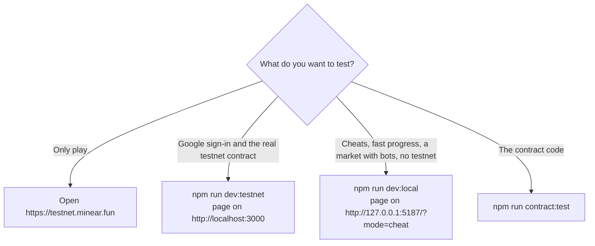
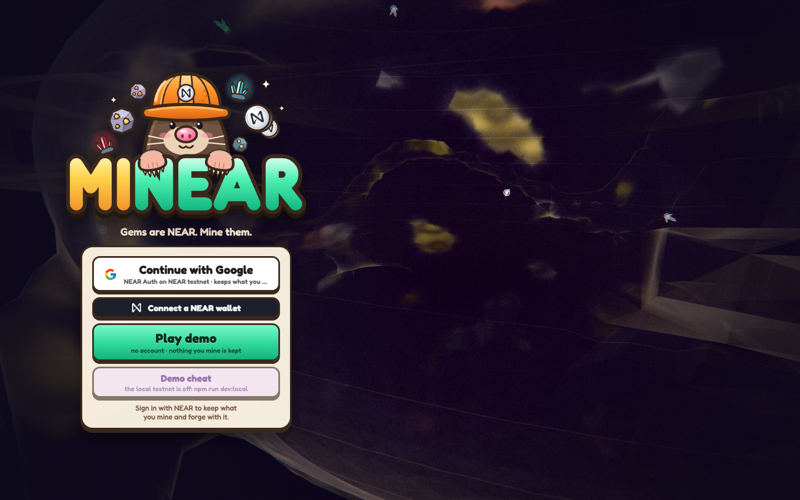

# How to run MINEAR

[Back to the README](../README.md) · [Merchants](ai-merchants.md) · [Contracts](contracts.md) · [Catalog](catalog.md)

All commands run in the root folder of this repository (local folder name `minear-r3f`).

## The three ways to play

| Where | Chain | Address | Sign-in | Cheats |
| - | - | - | - | - |
| Live demo | NEAR testnet | https://testnet.minear.fun | Google, NEAR wallet, or demo | No |
| Dev run on testnet | NEAR testnet (the same contract and accounts) | http://localhost:3000 | Google, NEAR wallet, or demo | No |
| Local testnet | A NEAR chain on your computer | http://127.0.0.1:5187/?mode=cheat | A local device account | Yes |



## 1. Tools

You need Node.js and [bun](https://bun.sh). To build the contract you also need Rust and `cargo-near`.

```bash
npm install
```

## 2. Dev run on NEAR testnet (Google sign-in)

This starts the MINEAR server on 127.0.0.1:8787 and the page on http://localhost:3000.

```bash
npm run dev:testnet
```



- Open the page as `http://localhost:3000`. Do not use `http://127.0.0.1:3000`.
- NEAR Auth's shared testnet login returns only to `http://localhost:3000`. On any other address, Google
  sign-in answers "Callback URL mismatch". A NEAR wallet works on any address.
- **Continue with Google** makes `<name>.minear.testnet` for you. There is no seed phrase.
- **Demo cheat** is off on this page until the local testnet runs (section 3).

The server needs the keys of the game accounts in `server/.keys/testnet/`. They are not in this repository.
To make your own deployment under a new root account (created from the testnet faucet):

```bash
bun server/tools/setup.ts --root <your-name>.testnet
```

## 3. Local testnet (cheat mode)

A full NEAR chain on your computer: the chain on 127.0.0.1:3030, the MINEAR server on 127.0.0.1:8788, the page
on http://127.0.0.1:5187/?mode=cheat, and six bot miners for 10 minutes so that the merchants have trades.

```bash
npm run dev:local
```

It needs the `near-sandbox` binary in `server/.sandbox/bin/`. The tool prints the download command when the
binary is missing. It does not download it.

What the cheat mode gives (dev runs on your computer only; a production build cannot turn it on):

| Cheat | Effect |
| - | - |
| Unlimited HP | Foes, bombs, burn and poison do no damage |
| Hidden from foes | Foes, bosses and the worm do not see you |
| Unlimited claw endurance | Mining does not wear the claws |
| Fast burrow | Burrow at x1, x2 or x3 speed through the rock you tick |
| Unlimited jetpack fuel | The jetpack never runs dry |
| Warps | Go to the four beast lairs at once |
| Stock up | Mints ores and gems to your account on the local chain |

Cheat mode never touches NEAR testnet. Google sign-in does not work on the local chain: NEAR Auth runs on
testnet only.

To make the local market move again after the first 10 minutes:

```bash
npm run local:bots
```

The parts one by one, when you do not want the full stack:

| Command | What it starts |
| - | - |
| `npm run local:chain` | Only the chain, in the foreground |
| `npm run local:setup` | The contract, the relayer and the merchant accounts on the local chain |
| `npm run local:server` | The MINEAR server for the local chain (127.0.0.1:8788) |
| `npm run local:bots` | The bot miners |

To start again with an empty chain: stop it, then delete `server/.sandbox/data`, `server/.sandbox/keys` and
`server/.sandbox/deploy.local.json`. Keep `server/.sandbox/bin/`.

## 4. Contract

```bash
npm run contract:test
```

```bash
npm run contract:build
```

## 5. End-to-end check

Against a running server. It creates a test player and plays one trip.

```bash
npm run near:smoke
```

## 6. Bots on testnet

They play real trips through the relayer and the contract, and they trade with the merchants. They stop by
themselves.

```bash
npm run near:bots
```

## 7. Settings

Every value has a default. To change one, copy `.env.example` to `.env.local` and remove the `#` of the line.

| Setting | Default | Meaning |
| - | - | - |
| `VITE_NEAR_AUTH_CLIENT_ID` | empty | Your own NEAR Auth client id. Empty: the shared testnet client (only `http://localhost:3000`). |
| `VITE_MINEAR_SERVER` | `http://127.0.0.1:8787` | The MINEAR server of the testnet page |
| `VITE_MINEAR_LOCAL_SERVER` | `http://127.0.0.1:8788` | The MINEAR server of the local testnet page |
| `MINEAR_NETWORK` | `testnet` | `testnet`, `local` or `mainnet` |
| `MINEAR_RELAY_DAILY_CAP` | 24000 on testnet | Game calls the relayer pays for in one UTC day, all players together |

## 8. Dev pages

On a dev run, these pages show the game data with no sign-in:

| Page | What it shows |
| - | - |
| `/dev/catalog/near` | Base buildings, Refinery, Forge, effects, Capsule Machine, skill tree, slots, Requests Board |
| `/dev/catalog` | Foes, bosses, gems, gear, characters and sky states |
| `/dev/terrain` | Rock layers, biome caverns and boss lairs |
| `/dev/bosses` | Each boss model, its animation clips, phases and effects |
| `/dev/intro` | The intro film |

## 9. Folders

| Folder | What it has |
| - | - |
| `src/` | The game (Three.js, TypeScript, Vite) and its NEAR client (`src/near/`) |
| `server/src/` | The MINEAR server: gas relayer, account setup, merchant agents |
| `server/tools/` | Setup, smoke test, bots, the local chain and the testnet dev run |
| `contracts/items/` | The game contract (Rust, near-sdk) |
| `public/` | 3D models and images |
| `wiki/` | These documents, their images, and the market model (`wiki/tools/market-model.ts`) |
